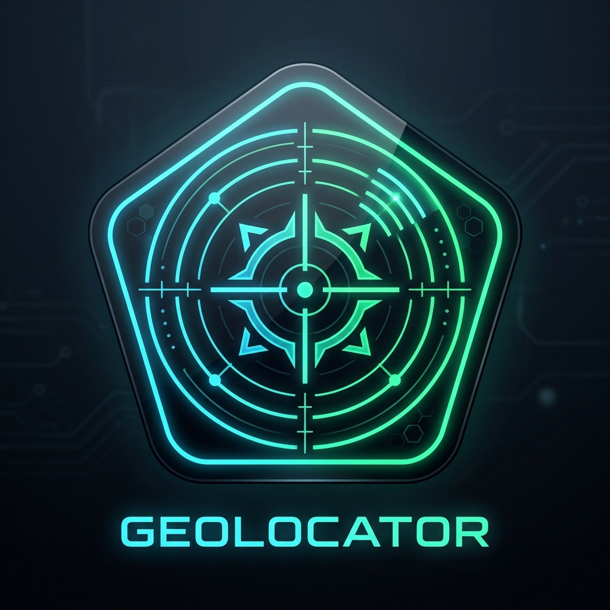
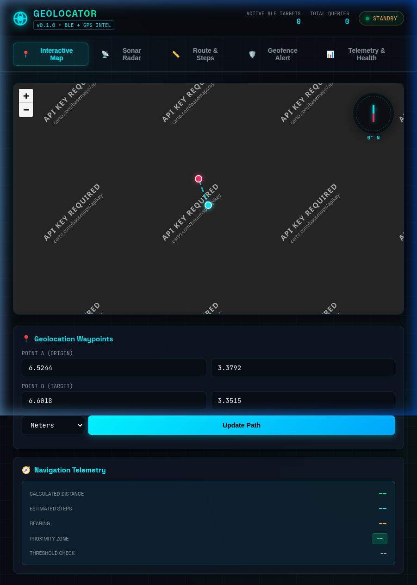
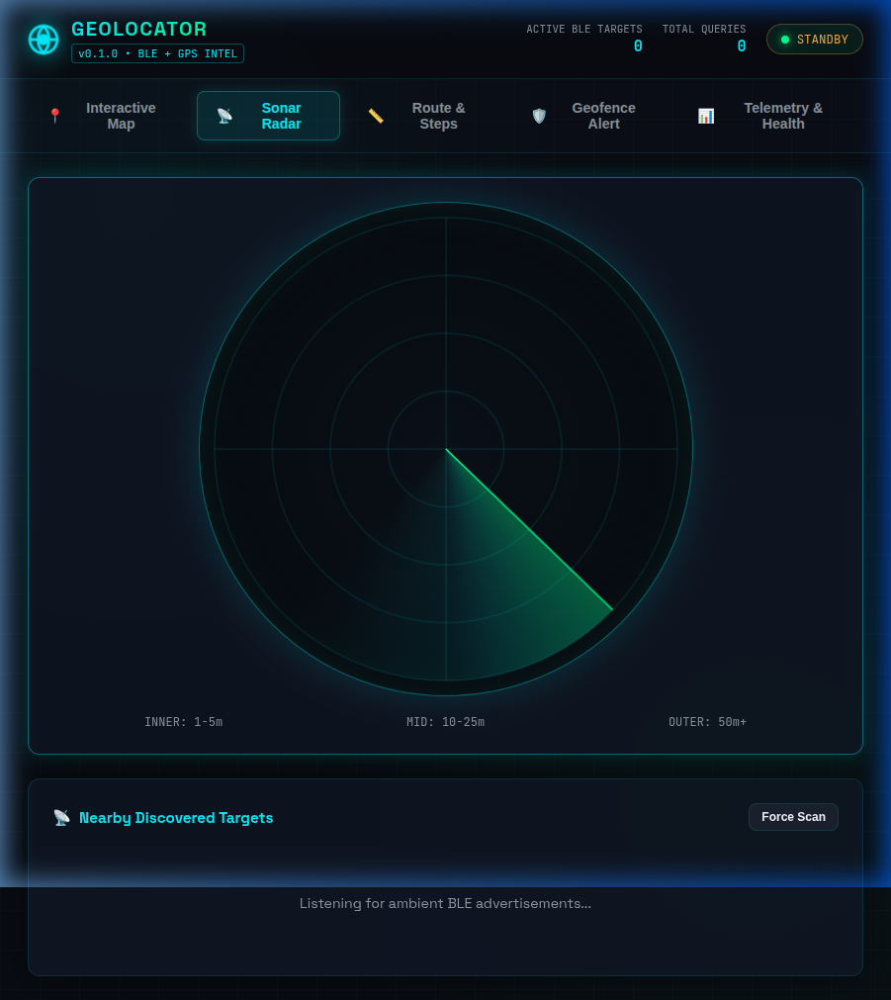
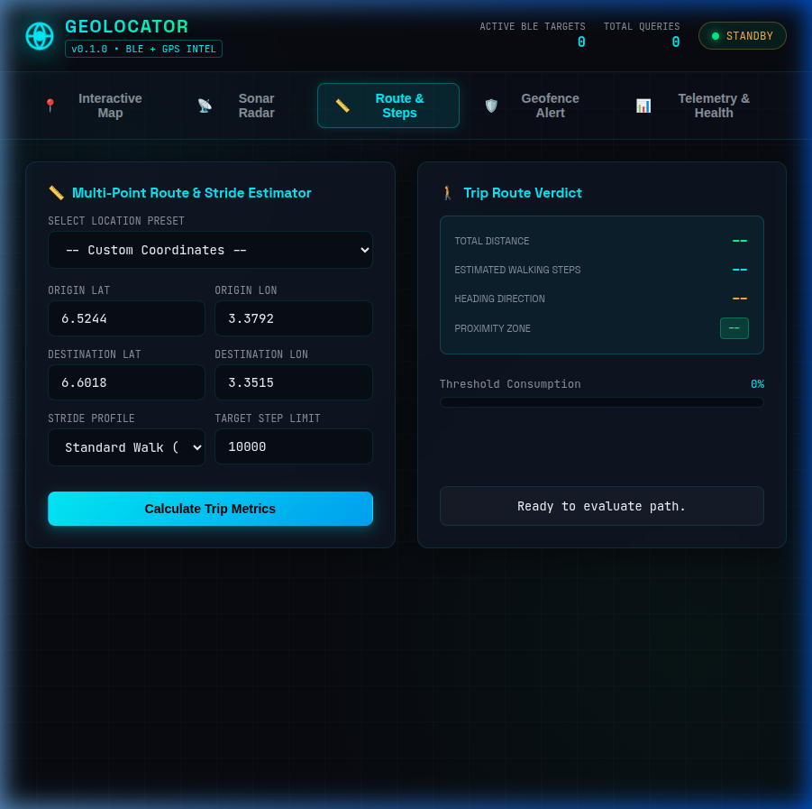

<div align="center">
  
  <h1 style="margin-top: 10px; font-size: 2.4rem; letter-spacing: 2px;">GEOLOCATOR</h1>
  <p><strong>Proximity-Aware Navigation & Real-Time Radar Intelligence Suite</strong></p>

  <p>
    
    
    
    
    
    
  </p>
</div>

---

## Overview

**Geolocator** transforms raw geospatial math and ambient radio signals into real-time proximity intelligence. It merges **deterministic GPS spherical geometry** (Haversine distance, bearing angles, and human stride conversions) with **live Bluetooth Low Energy (BLE) hardware scanning** enhanced by a **1D Kalman filter** to measure real physical proximity.

Whether navigating between global coordinates or monitoring in-room BLE peripherals, Geolocator delivers a unified, production-ready system equipped with a high-performance **Actix Web backend** and a futuristic **Vite geospatial dashboard**.

---

## Visual Showcase

### 📍 Interactive Geospatial Map
Drag-and-drop origin and target waypoints on dark cartography with live geodetic path lines, dynamic rotating compass needle HUD, step consumption metrics, and proximity zone classification.

<div align="center">
  
</div>

<br/>

### 📡 360° Sonar BLE Radar
Real-time animated Canvas sonar sweep plotting detected Bluetooth devices according to calibrated RSSI signal distance, featuring dynamic approaching/receding trend indicators and historical signal sparklines.

<div align="center">
  
</div>

<br/>

### 📏 Route & Steps Estimator
Evaluate multi-city waypoint routes (with presets for Lagos, London, NYC, and Tokyo), calculate custom walking/running stride consumption against daily step limits, and monitor geofence containment alarms.

<div align="center">
  
</div>

---

## Core Features

- 📍 **Deterministic GPS Navigation**: Great-circle distance (Haversine formula), compass bearing in degrees ($0^\circ - 360^\circ$), 8-point cardinal direction resolution, and multi-unit conversions (`m`, `km`, `mi`, `ft`).
- 📡 **Hardware BLE Scanning & Mock Supervisor**: Continuous background BLE adapter discovery (`btleplug`) with automatic fallback to simulated beacon generation (`MOCK_BLUETOOTH=true`) for headless Docker and cloud deployments.
- 📉 **Kalman Signal Smoothing & Trends**: 1D Kalman filter dampening noisy RSSI fluctuations, accompanied by trajectory trend detection (`approaching`, `receding`, `stationary`) and in-memory ring-buffer history.
- 🛡️ **Circular Geofencing Engine**: Dynamic perimeter containment evaluation with boundary margin calculation and proximity zone categorization (`immediate`, `near`, `vicinity`, `distant`).
- ⚡ **Real-Time SSE Telemetry Stream**: Server-Sent Events (`GET /events`) broadcasting peripheral sightings and RSSI fluctuations directly to connected clients over broadcast channels.
- 📊 **Operational Diagnostics**: In-memory registry tracking query counts, uptime, and active peripheral tallies via `GET /health` and `GET /metrics`.
- 📖 **OpenAPI 3.0 & Swagger**: Complete API specification in `openapi.yaml` served live at `/openapi.yaml`.
- 🐳 **Multi-Stage Containerization**: Hardened 3-stage `Dockerfile` building both the Vite frontend bundle and Rust binary in a slim Debian runtime.

---

## Quickstart

### 1. System Dependencies (Linux)

To compile the native Bluetooth D-Bus bindings:

```bash
sudo apt-get update && sudo apt-get install -y libdbus-1-dev pkg-config
```

### 2. Run the Backend

```bash
# Standard mode (uses physical Bluetooth adapter if present, auto-falls back to mock if absent):
cargo run

# Explicit mock mode (simulates live drifting beacons for testing or cloud environments):
MOCK_BLUETOOTH=true cargo run
```

*The Actix Web server binds to `http://0.0.0.0:8080` (or reads `$PORT`).*

### 3. Run the Frontend Dashboard

In a separate terminal:

```bash
cd frontend
npm install
npm run dev
```

*Open **`http://localhost:5173`** in your browser to launch the HUD.*

### 4. Run with Docker

```bash
# Build unified multi-stage container
docker build -t geolocator .

# Run container
docker run -p 8080:8080 geolocator
```

---

## API Reference

| Method | Endpoint | Description |
|---|---|---|
| `GET` | `/` | Basic server ping |
| `GET` | `/health` | System health check, uptime, and active peripheral counts |
| `GET` | `/metrics` | Operational query counters and telemetry |
| `POST` | `/distance?unit=km&step_threshold=10000` | Great-circle GPS distance, bearing, and step estimation |
| `POST` | `/proximity` | Combined GPS distance + phone Bluetooth status verdict |
| `POST` | `/geofence` | Circular boundary containment and margin evaluation |
| `GET` | `/scan` | Sorted list of currently active BLE devices (closest first) |
| `GET` | `/history/{device_id}` | Historical RSSI trajectory and trend for a device |
| `GET` | `/events` | Server-Sent Events (SSE) live telemetry stream |
| `GET` | `/openapi.yaml` | OpenAPI 3.0 specification file |

### Example Queries

#### 1. GPS Distance Calculation
```bash
curl -X POST "http://127.0.0.1:8080/distance?unit=km" \
  -H "Content-Type: application/json" \
  -d '{"lat1": 6.5244, "lon1": 3.3792, "lat2": 6.6018, "lon2": 3.3515}'
```

#### 2. Geofence Boundary Check
```bash
curl -X POST http://127.0.0.1:8080/geofence \
  -H "Content-Type: application/json" \
  -d '{
    "center_lat": 6.5244,
    "center_lon": 3.3792,
    "radius_meters": 2000.0,
    "target_lat": 6.5280,
    "target_lon": 3.3810
  }'
```

#### 3. Live Server-Sent Events Stream
```bash
curl -N http://127.0.0.1:8080/events
```

---

## Verification & Testing

Run the full unit and integration test suite:

```bash
cargo test
```

Build the production frontend bundle:

```bash
cd frontend && npm run build
```

---

## Contributors

Thanks to all the contributors who built and improved Geolocator!

<table>
  <tr>
    <td align="center"><a href="https://github.com/greatKhalifa-code"><br /><sub><b>greatKhalifa-code</b></sub></a></td>
    <td align="center"><a href="https://github.com/queentiffany1111-cloud"><br /><sub><b>queentiffany1111-cloud</b></sub></a></td>
    <td align="center"><a href="https://github.com/dangerous-funds"><br /><sub><b>dangerous-funds</b></sub></a></td>
    <td align="center"><a href="https://github.com/betiniSparks"><br /><sub><b>betiniSparks</b></sub></a></td>
    <td align="center"><a href="https://github.com/dangerous-fundz"><br /><sub><b>dangerous-fundz</b></sub></a></td>
    <td align="center"><a href="https://github.com/davidajohhnson"><br /><sub><b>davidajohhnson</b></sub></a></td>
  </tr>
  <tr>
    <td align="center"><a href="https://github.com/Dev-Chizzy"><br /><sub><b>Dev-Chizzy</b></sub></a></td>
    <td align="center"><a href="https://github.com/zicogoodness"><br /><sub><b>zicogoodness</b></sub></a></td>
    <td align="center"><a href="https://github.com/nathanfrealmusic"><br /><sub><b>nathanfrealmusic</b></sub></a></td>
    <td align="center"><a href="https://github.com/the-Devdrago"><br /><sub><b>the-Devdrago</b></sub></a></td>
    <td align="center"><a href="https://github.com/bixbyhalleluyah"><br /><sub><b>bixbyhalleluyah</b></sub></a></td>
    <td align="center"><a href="https://github.com/computeroracleinc"><br /><sub><b>computeroracleinc</b></sub></a></td>
  </tr>
</table>

---

## License

This project is licensed under the [MIT License](LICENSE).
